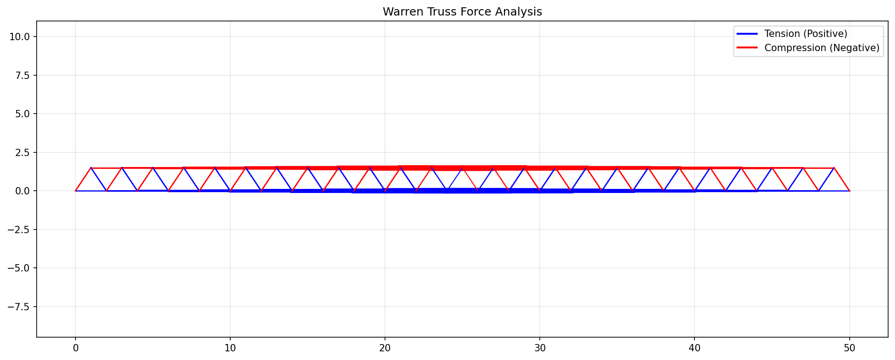

# Warren Truss Structural Analysis

[](https://opensource.org/licenses/MIT)
[](https://www.python.org/downloads/)

This project performs a numerical analysis of a **Warren Truss** bridge. It models the bridge as a linear system $Ax = b$ and compares different Gaussian elimination methods (Naive vs. Partial Pivoting) against NumPy's high-performance solvers.

## 🚀 Key Features
- **Structural Modeling**: Generates equilibrium equations for a Warren Truss bridge.
- **Numerical Solvers**: Custom implementations of Gaussian elimination (Naive and Partial Pivoting) and comparison with NumPy.
- **Sparsity Analysis**: Demonstrates that the system matrix is ~97% sparse and analyzes memory efficiency.
- **Visualization**: Beautiful force distribution plots (Tension vs. Compression).

## 📊 Results Summary
The analysis clearly shows that **partial pivoting is critical** for stability in structural problems. Naive Gaussian elimination often fails due to zero pivots or produces high residuals.

| Method | Time (s) | Residual | Status |
| :--- | :--- | :--- | :--- |
| **NumPy (Standard)** | ~0.0005 | $10^{-10}$ | ✅ Success |
| **Gauss Partial Pivoting** | ~0.0071 | $10^{-10}$ | ✅ Success |
| **Gauss Naive** | N/A | High / Error | ❌ Failed |

Relative Error vs NumPy (GPP): ~6.4e-16

## 🛠️ Installation & Usage

1. **Clone the repository**:
   ```bash
   git clone https://github.com/tankistkebab/WarrenTruss.git
   cd WarrenTruss
   ```

2. **Install dependencies**:
   ```bash
   pip install -r requirements.txt
   ```

3. **Run the analysis**:
   Open the Jupyter Notebook to see the full analysis:
   ```bash
   jupyter notebook warren_truss_analysis.ipynb
   ```

## 🧪 Testing
Run the automated tests to verify solver accuracy and physical consistency (equilibrium of forces):
```bash
python -m pytest
```



## 📝 Project Structure
- `truss.py`: Bridge geometry and $Ax=b$ system generation.
- `solvers.py`: Custom Gaussian elimination and sparse solvers.
- `warren_truss_analysis.ipynb`: Main presentation and visualization.
- `tests/`: Unit tests for verification.

## ⚖️ License
Distributed under the MIT License. See `LICENSE` for more information.

---
*Developed as a project to demonstrate the link between structural engineering and numerical analysis.*
